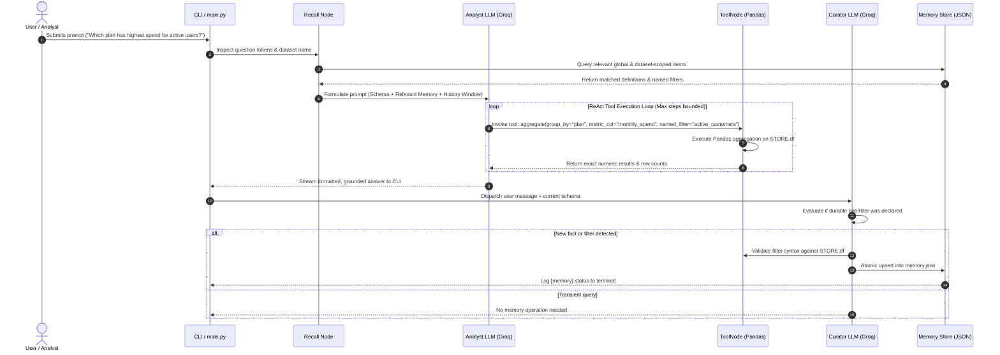

# Data Analyst Agent — Complete Knowledge & Architectural Guide

Welcome to the definitive knowledge base for the **Data Analyst Agent**. This document is designed for developers, evaluators, and stakeholders to understand both the **theoretical principles** behind the system and the **practical engineering/technical stack** that powers it.

---

## 1. Executive Summary & Core Purpose

Modern Large Language Models (LLMs) excel at language interpretation and synthetic reasoning, but suffer from significant flaws when performing direct numeric calculations and tabular data retrieval:
1. **Hallucination of Numbers:** Generating plausible-looking averages, percentages, or metrics without executing arithmetic on the underlying records.
2. **Context Window Saturation:** Attempting to stuff raw datasets of tens of thousands of rows directly into model prompts, causing prohibitive latency, sky-high token costs, and context truncation.
3. **Stateless Amnesia:** Forgetting business domain rules (e.g., *"churned means account status is inactive or cancelled"*) between query turns or across sessions.

### The Solution
The **Data Analyst Agent** is a multi-agent, tool-augmented system built on **LangGraph**, **LangChain Core**, **Pandas**, and **Groq (LPU Inference)**. 
- It treats the LLM strictly as an **orchestrator and interpreter**, never an arithmetic calculator.
- All data computations are delegated to deterministic, typed analysis tools running on in-memory DataFrames.
- It features an autonomous **persistent semantic memory engine** that curates business rules and reusable query filters across sessions without polluting prompt state.

---

## 2. Theoretical Foundations: What Is Happening Conceptually?

### 2.1 The ReAct Loop (Reasoning + Acting)
The agent operates on the classical **ReAct** paradigm:
$$\text{Observe Context} \longrightarrow \text{Thought (Reasoning)} \longrightarrow \text{Action (Tool Call)} \longrightarrow \text{Observation (Data Result)} \longrightarrow \text{Answer}$$

Instead of producing a direct response immediately, the agent evaluates the user's intent, inspects the dataset schema, and chooses the most appropriate analytical instrument (e.g., ANOVA hypothesis testing vs. grouping vs. time series bucketing).

```
User Query
    │
    ▼
[ Recall Node ] ──► Extracts relevant domain knowledge & filters
    │
    ▼
[ Analyst LLM ] ──► Reasons on query & schema; issues tool invocation
    ▲     │
    │     ▼ (Tool Call)
    │   [ ToolNode ] ──► Executes Pandas/SciPy calculation on real data
    │     │
    └─────┘ (Observation returned; loops until complete)
          │
          ▼ (Final Synthesized Text)
[ Curator LLM ] ──► Analyzes user prompt for durable facts & updates Memory Store
    │
    ▼
End User Response
```

### 2.2 Multi-Agent Separation of Concerns (Analyst vs. Curator)
Many agent architectures suffer from prompt bloat when forcing a single model instance to simultaneously conduct complex data analysis, formulate formatting styles, and manage long-term knowledge curation.

This system splits responsibilities into two distinct cognitive roles:
1. **The Analyst Agent:**
   - **Role:** Data scientist / Quantitative investigator.
   - **Objective:** Answer the user's immediate analytical question accurately using tools.
   - **Constraints:** Enforced rule to *never guess numbers*; must ground statements in tool observation data.
2. **The Curator Agent:**
   - **Role:** Knowledge base maintainer / Librarian.
   - **Objective:** Silently inspect the interaction turn to extract durable user preferences, entity definitions, and reusable pandas query filters.
   - **Constraints:** Strips conversational chit-chat; never stores raw data or transient answers; executes atomic JSON updates/deletions.

### 2.3 Grounded Data Auditing
Every response can be traced back to exact computations. Tools echo back:
- The rows filtered or evaluated.
- The aggregation formula executed.
- The statistical confidence levels or standard deviations observed.
This guarantees verifiable analytical provenance.

---

## 3. System Architecture & Technical Stack

```
┌────────────────────────────────────────────────────────────────────────┐
│                              USER LAYER                                │
│       CLI Interface (main.py) / Commands (/load, /schema, /memory)     │
└───────────────────────────────────┬────────────────────────────────────┘
                                    │
                                    ▼
┌────────────────────────────────────────────────────────────────────────┐
│                        LANGGRAPH STATE MACHINE                         │
│                                                                        │
│  ┌────────────┐      ┌─────────────┐       Tool Call   ┌────────────┐  │
│  │   recall   │ ───► │   analyst   │ ────────────────► │   tools    │  │
│  └────────────┘      └─────────────┘ ◄──────────────── └────────────┘  │
│                             │           Tool Observation               │
│                             │ (Final answer produced)                  │
│                             ▼                                          │
│                      ┌─────────────┐                                   │
│                      │   curator   │ ──► writes to memory/memory.json  │
│                      └─────────────┘                                   │
└───────────────────────────────────┬────────────────────────────────────┘
                                    │
       ┌────────────────────────────┼───────────────────────────┐
       ▼                            ▼                           ▼
┌──────────────┐             ┌──────────────┐            ┌──────────────┐
│  Groq Cloud  │             │ In-Memory DF │            │ Disk Storage │
│ (Qwen / LPU) │             │ (Pandas/NumPy│            │ (JSON Memory,│
│              │             │  SciPy Stats)│            │  PNG Charts) │
└──────────────┘             └──────────────┘            └──────────────┘
```

### 3.1 Technology Stack Details

| Component | Technology | Rationale & Responsibility |
|---|---|---|
| **Graph Orchestration** | `LangGraph` (`StateGraph`) | Explicit cycle control (`analyst ⇄ tools`), typed state transitions, recursion caps, and session checkpointing. |
| **Tool Specification** | `langchain-core` | Structured `@tool` decorator schemas with typed parameters for LLM function calling. |
| **Inference Engine** | `langchain-groq` | Ultra-fast LPU inference via Groq cloud API (defaulting to open-weights architectures such as `qwen/qwen3-32b` or configured alternatives). |
| **Data Engine** | `pandas`, `numpy`, `scipy` | In-memory vectorized transformations, ANOVA F-tests, correlation matrices, IQR/Z-score outlier detection. |
| **Visualization** | `matplotlib` | Headless chart generation exporting publication-grade PNG visualizations into `outputs/`. |
| **Persistent Memory** | Pure Python + JSON (`memory/memory.json`) | Transparent, inspectable, human-editable, deterministic dictionary-based memory store. |

---

## 4. Analytical Tool Suite (The 9 Built-in Tools)

The system provides 9 purpose-built tools covering 7 distinct analytical dimensions. Columns are validated at invocation time, and fuzzy string matching (`difflib`) guides the LLM to self-correct typos without manual intervention.

```
                     ┌── Profiling: describe_dataset
                     ├── Retrieval & Filtering: query_rows
                     ├── Aggregations: aggregate
                     ├── Longitudinal: trend_over_time
Analytical Spectrum  ├── Correlation: correlation_analysis
                     ├── Hypothesis Testing: compare_groups
                     ├── Anomaly Detection: detect_outliers
                     ├── Data Visualization: plot_chart
                     └── Dynamic Pandas Fallback: run_python
```

### 4.1 Detailed Tool Capabilities

1. **`describe_dataset(columns=None)`**
   - Profiles shape, null counts, memory usage, inferred dtypes, and quantile summary statistics.
2. **`query_rows(filter_expr="", named_filter="", sort_by="", ascending=False, limit=10, columns=None)`**
   - Retrieves granular rows matching ad-hoc boolean queries or remembered business filters.
3. **`aggregate(group_by, metric_col, agg_func="mean", filter_expr="", named_filter="")`**
   - Computes summary statistics (`mean`, `sum`, `median`, `std`, `nunique`, etc.) grouped by categorical dimensions.
4. **`trend_over_time(date_col, metric_col, freq="ME", agg_func="sum", filter_expr="", named_filter="")`**
   - Performs datetime bucketing (Daily `D`, Weekly `W`, Monthly `ME`, Quarterly `QE`, Yearly `YE`) calculating period-over-period delta and percentage growth.
5. **`correlation_analysis(col_a, col_b, method="pearson", filter_expr="", named_filter="")`**
   - Computes Pearson or Spearman rank correlation coefficients, warning against confounding factors.
6. **`compare_groups(cat_col, num_col, filter_expr="", named_filter="")`**
   - Performs One-Way Analysis of Variance (ANOVA F-test) between groups, calculating $p\text{-value}$ and effect size ($\eta^2$ / Eta-squared) to formally test whether category differences are statistically significant.
7. **`detect_outliers(col, method="iqr", factor=1.5, filter_expr="", named_filter="")`**
   - Identifies distribution anomalies via Interquartile Range ($Q_1 - 1.5 \times \text{IQR}$, $Q_3 + 1.5 \times \text{IQR}$) or Z-score ($|Z| > 3.0$).
8. **`plot_chart(chart_type, x_col, y_col=None, kind_col=None, title="", filter_expr="", named_filter="")`**
   - Generates and writes styled bar, line, scatter, box, or histogram PNG plots to disk with high DPI.
9. **`run_python(code)`**
   - Sandboxed fallback for complex multi-step transformations; filtered to prevent dangerous system calls or filesystem tampering (`os`, `sys`, `subprocess`, `open`).

---

## 5. Persistent Memory Engine & Knowledge Curation

Unlike typical conversational memory that merely dumps previous messages back into the prompt buffer, this system implements **Semantic Knowledge Curation**.

### 5.1 Memory Types & Taxonomy
Every remembered item has an explicit schema:
$$\text{Memory Item} = \{ \text{id}, \text{type}, \text{key}, \text{value}, \text{scope}, \text{created}, \text{updated}, \text{history} \}$$

| Memory Type | Description | Example |
|---|---|---|
| `definition` | Explains business context, metrics, or domain terms. | `key='churn'`, `value='status == "cancelled"'` |
| `named_filter` | Reusable Pandas query expression that automatically binds to tool calls. | `key='high_value'`, `value='monthly_spend > 150'` |
| `preference` | User stylistic preference for analysis output. | `key='time_unit'`, `value='summarize in weekly chunks'` |
| `correction` | User overrides or adjustments to earlier conclusions. | `key='region_mapping'`, `value='APAC does not include AU'` |

### 5.2 Scoping & Conflict Resolution
- **Scoping:** Items are scoped as either `global` (general preferences applicable everywhere) or `dataset` (tied specifically to the current file schema, e.g., `customers.csv`).
- **Conflict Handling:** When an existing `(type, key, scope)` receives an updated definition, the previous value is pushed into the `history` log with a timestamp, while the new value becomes active.
- **Precedence Rule:** If a user's prompt in the current turn contradicts a saved memory item, the **current user prompt always wins**.
- **Execution Validation:** Before saving any `named_filter`, the Curator runs the filter string against the live DataFrame. If invalid syntax or nonexistent column names are provided, the filter is rejected with an explanatory message.

---

## 6. Execution Flow & State Machine

The interaction cycle is defined by the following sequence:



---

## 7. Safety, Guardrails & Reliability Mechanisms

1. **Tool Budget Limit:** `MAX_TOOL_STEPS` (default: 6) prevents infinite looping or runaway API costs. If the budget is exhausted, a steering prompt forces the Analyst to answer with currently aggregated data.
2. **Context History Windowing:** Keeps only the last $N$ turns (`HISTORY_TURNS = 4`) of conversational history while preserving active tool interactions, preventing prompt blowout.
3. **Safe Error Reflection:** When tools encounter missing columns or malformed query expressions, clean exceptions return to the LLM context (`handle_tool_errors=True`), allowing the model to self-heal.
4. **Code Restriction:** In `run_python`, dangerous built-in modules (`os`, `sys`, `shutil`, `subprocess`) and built-in filesystem hooks (`open`, `exec`, `eval`) are blocked to safeguard the host machine.
5. **Output Truncation:** Large tabular outputs are truncated at `MAX_TOOL_OUTPUT_CHARS` (3,500 characters) to ensure responses never flood downstream context buffers.

---

## 8. Directory & File Inventory

```
data-analyst-agent/
│
├── da_agent/                      # Core agent framework package
│   ├── __init__.py                # Package initialization
│   ├── config.py                  # Global settings, paths, environment configuration
│   ├── data.py                    # Dataset loading (CSV/XLSX/Parquet/JSON) & schema extraction
│   ├── llm.py                     # Groq LLM factory & model binding
│   ├── memory.py                  # MemoryStore class, keyword retrieval, conflict tracker
│   ├── tools.py                   # The 9 analysis tools, Pandas/SciPy/Matplotlib runners
│   └── graph.py                   # LangGraph workflow, system prompts, StateGraph setup
│
├── sample_data/                   # Demo tabular data files
│   ├── customers.csv              # Synthetic customer SaaS data
│   ├── sales.csv                  # Multi-region sales transactions
│   └── make_sample_data.py        # Reproducible synthetic data generation script
│
├── tests/                         # Pytest test suite
│   └── test_core.py               # Deterministic tests for tools & memory (no API key needed)
│
├── memory/                        # Runtime persistent storage
│   └── memory.json                # Persisted knowledge items
│
├── outputs/                       # Output artifacts directory
│   └── (saved charts/PNGs)        # Matplotlib visualization exports
│
├── main.py                        # Interactive CLI & batch execution interface
├── requirements.txt               # Python package dependencies
├── .env.example                   # Environment variable template
├── CONTEXT.md                     # Initial project briefing & interview prep
└── KNOWLEDGE_AND_ARCHITECTURE.md  # Comprehensive theoretical & technical reference
```

---

## 9. Quickstart & Verification Guide

### Step 1: Environment Setup
```powershell
python -m venv .venv
.venv\Scripts\activate
pip install -r requirements.txt
Copy-Item .env.example .env
# Open .env and add your GROQ_API_KEY
```

### Step 2: Run Offline Verification
Test the tools and memory mechanics without expending any LLM tokens:
```powershell
python -m pytest -q
```

### Step 3: Run Interactive Analysis
Launch the CLI with a sample dataset:
```powershell
python main.py sample_data/customers.csv
```

### Step 4: Example Conversational Walkthrough
```text
you> What columns are in this dataset and are there any missing values?
  [tool] describe_dataset({})
  (Agent returns structured schema and column profiles)

you> Average monthly spend by plan?
  [tool] aggregate({"group_by": "plan", "metric_col": "monthly_spend"})
  (Agent calculates exact means from DataFrame)

you> Active customers means status is not cancelled. Remember this.
  [memory] added named_filter 'active_customers' = status != 'cancelled'

you> How many active customers do we have per region?
  [tool] aggregate({"group_by": "region", "metric_col": "customer_id", "agg_func": "count", "named_filter": "active_customers"})
  (Agent automatically applies the saved memory filter without needing re-explanation)
```

---

## 10. Summary Checklist for Interviews & Technical Defense

| Topic | Key Talking Point |
|---|---|
| **Why LangGraph over LangChain Agents?** | LangGraph provides an explicit, observable cyclic state machine where nodes represent discrete agents and tools with typed state buffers. |
| **How are hallucinated numbers eliminated?** | System prompt mandate: no number may be cited without tool observation evidence; tools return audited calculations from Pandas. |
| **Why 2 agents instead of 1?** | Complete cognitive separation between analytical inquiry (Analyst) and memory curation (Curator), eliminating prompt interference. |
| **Why not let the LLM generate arbitrary code for everything?** | Typed tools provide predictable, repeatable, unit-testable performance; arbitrary code generation is reserved as a restricted fallback. |
| **How is memory kept clean?** | Rigid typed schemas, keyword-based scoring, live dataset validation of filters, update history preservation, and manual user override commands (`/forget`, `/clear-memory`). |
